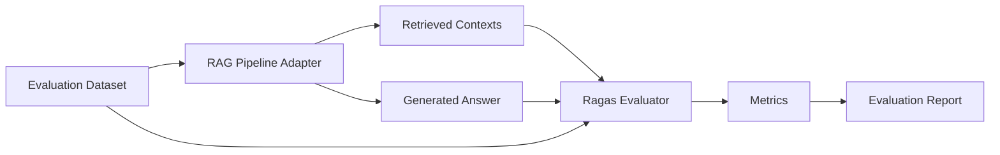

# Standalone RAG Evaluation Module

This directory contains a separate evaluation workflow for the Agentic RAG helpdesk system. It is intentionally isolated from the main application logic so that the evaluation process can be inspected, demonstrated, and improved without modifying the production RAG pipeline.

## 1. What is RAG evaluation?

A Retrieval-Augmented Generation (RAG) system is typically judged by two things:

- whether it retrieves the right evidence
- whether it generates an answer grounded in that evidence

RAG evaluation checks whether the model is hallucinating, missing key information, or answering questions with weak or irrelevant context.

## 2. Why evaluation matters

A helpdesk assistant may produce an answer that sounds confident but is not supported by internal documents. This is especially risky in enterprise settings where employees rely on precise, trustworthy guidance.

Evaluation helps answer key questions:

- Did the retriever find the relevant knowledge?
- Did the model use the retrieved context correctly?
- Did the answer address the user question?
- Did the model hallucinate or omit critical information?

## 3. Why use Ragas?

Ragas is a framework designed specifically for evaluating RAG systems. It measures retrieval quality and answer quality in a structured way and provides metrics for faithfulness, relevancy, and context coverage.

This project uses Ragas 0.4.3 with the installed LangChain ecosystem. The evaluation package is built to match the currently installed environment and the project’s actual retrieval and generation flow.

## 4. Metrics used

This module evaluates the RAG output using four Ragas metrics:

### Faithfulness

Measures whether the generated answer is supported by the retrieved contexts. It helps identify unsupported claims and hallucinations.

### Answer Relevancy

Measures whether the generated answer actually addresses the user question. It helps identify generic or off-topic responses.

### Context Precision

Measures whether the documents selected by retrieval are ranked in a way that places the most relevant content first. It is useful for evaluating retrieval quality.

### Context Recall

Measures whether the retrieved contexts contain the information needed to answer the user question. It helps reveal whether important evidence was missed by the retriever.

## 5. Architecture



## 6. Dataset structure

The evaluation dataset is stored in JSON and contains entries with:

- `user_input`
- `reference`

The `reference` field is the expected answer based on relevant company documentation. These examples are illustrative and should be replaced with verified internal knowledge before real production evaluation.

## 7. How actual RAG outputs are collected

The evaluation module does not fabricate answers or contexts.

It uses the existing application pipeline through a small, isolated adapter:

- it calls the existing RAG workflow for the user question
- it retrieves the current contexts using the existing retriever
- it stores the actual answer and context for scoring

This design keeps the evaluation separate from the main Agentic RAG application while using the same working retrieval and generation flow.

## 8. How the evaluation works

1. Load the JSON dataset.
2. For each question, call the actual RAG pipeline.
3. Collect the generated answer and retrieved contexts.
4. Prepare the dataset in the format expected by Ragas.
5. Run the selected metrics.
6. Save the results in JSON and CSV formats.
7. Display the report in the terminal.

## 9. Configuration

The evaluation package reads environment variables from the project root `.env` file using the same convention already used by the application.

Expected variables include:

- `GOOGLE_API_KEYS` or `GOOGLE_API_KEY`
- `GEMINI_MODEL`
- `EMBEDDING_MODEL`

The evaluation logic does not expose secrets in generated reports or logs.

## 10. How to run it

From the project root:

```bash
python -m rag_evaluation.run_evaluation
```

Optional limit:

```bash
python -m rag_evaluation.run_evaluation --limit 3
```

## 11. How to interpret results

The output report includes the question, generated answer, reference answer, and metric scores. A good RAG system should show:

- high faithfulness
- high answer relevancy
- strong context precision
- strong context recall

Low scores usually indicate one of the following:

- the retriever is missing relevant evidence
- the answer is generic or off-topic
- the model uses unsupported claims
- the reference text is too strict or mismatched to the actual document language

## 12. Guardrails vs evaluation

Guardrails and evaluation serve different goals.

- Guardrails protect the application by blocking unsafe input and weak output.
- Evaluation measures whether the RAG system is retrieving and answering correctly.

Both are useful, but they are not the same concept.

## 13. Known limitations

- The dataset is illustrative and should be replaced with verified company policy documents before production use.
- Real scoring depends on the quality of the underlying company documents.
- Live evaluation uses the actual model and retriever and may vary with API availability and model responses.
- The current implementation evaluates the actual application pipeline but keeps the evaluator separate and modular.

## 14. Future improvements

- Add more domain-specific questions.
- Include stricter company policy references.
- Add automatic summary generation for each run.
- Add a comparison between multiple retrieval strategies.
- Save result snapshots over time for model quality tracking.
